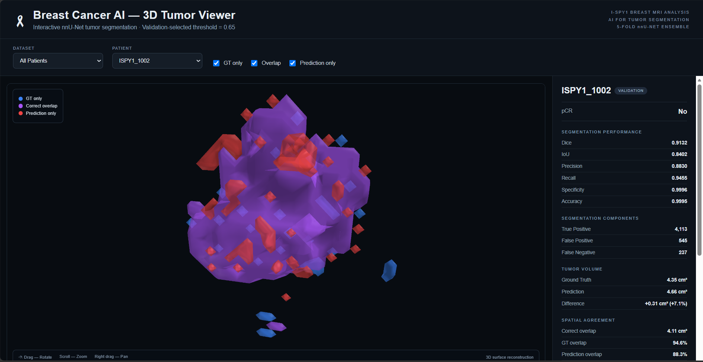
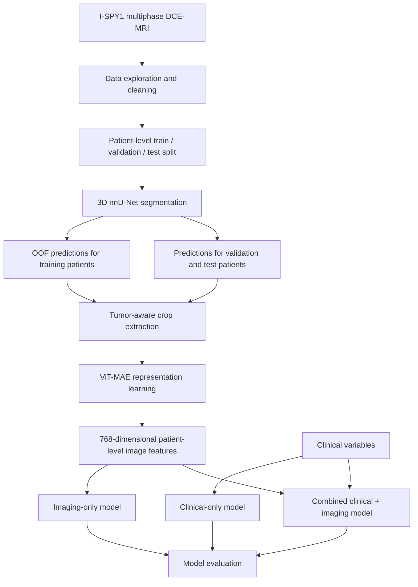

<div align="center">

# 🎗️ Breast Cancer AI
### 3D Breast Tumor Segmentation and pCR Prediction Using DCE-MRI, nnU-Net, ViT-MAE and Clinical Features


### 👉 [**Launch the Interactive 3D Tumor Viewer**](https://vanshika900.github.io/Breast_Cancer_AI/) 👈



*Explore 3D tumor segmentations and compare model predictions with expert annotations.*

</div>

---

## 📖 Table of Contents

1. [Project Overview](#-project-overview)
2. [Research Question and Objectives](#-research-question-and-objectives)
3. [Dataset](#-dataset)
4. [End-to-End Pipeline](#-end-to-end-pipeline)
5. [Methodology](#-methodology)
6. [Experimental Results](#-experimental-results)
7. [Interactive 3D Viewer](#-interactive-3d-viewer)
8. [Repository Structure](#-repository-structure)
9. [Reproducibility](#-reproducibility)
10. [Limitations and Future Work](#-limitations-and-future-work)
11. [References and Credits](#-references-and-credits)

---

## 🧠 Project Overview

Pathological complete response (pCR) after neoadjuvant treatment is an important outcome in breast cancer research. This project investigates an end-to-end pipeline that combines automated 3D tumor segmentation, imaging representation learning and clinical variables to study pCR prediction from Dynamic Contrast-Enhanced Magnetic Resonance Imaging (DCE-MRI).

The workflow has two connected parts:

1. **Tumor segmentation:** nnU-Net is used to segment breast tumors from multiphase DCE-MRI.
2. **pCR prediction:** tumor-aware image crops are processed using a pretrained Vision Transformer with a Masked Autoencoder (ViT-MAE). Patient-level imaging representations are then evaluated alongside clinical features using machine-learning classifiers.

The classification experiments compare three feature settings:

- Clinical-only
- Imaging-only
- Combined clinical and imaging features

The aim is to investigate whether imaging representations provide additional predictive information beyond clinical variables.

> **Research project only. Not a medical device. The models are not intended for diagnosis, treatment selection or clinical decision-making.**

---

## 🎯 Research Question and Objectives

**Research question:** Do tumor-aware imaging representations learned from DCE-MRI provide additional information for pCR prediction beyond clinical variables alone?

Objectives:

1. Develop and evaluate an automated 3D breast tumor segmentation pipeline using nnU-Net.
2. Generate tumor-aware image crops from segmentation predictions while avoiding ground-truth mask leakage into downstream training crops.
3. Learn patient-level imaging representations using ViT-MAE.
4. Compare clinical-only, imaging-only and combined models for pCR prediction.

---

## 🗂️ Dataset

The project uses the **I-SPY1** cohort from the [BreastDCEDL dataset](https://zenodo.org/records/17274053), a curated DCE-MRI release derived from The Cancer Imaging Archive (TCIA).

| Attribute | Description |
|---|---|
| Cohort | I-SPY1 |
| Imaging modality | Dynamic Contrast-Enhanced MRI (DCE-MRI) |
| Input phases | Three DCE time-points |
| Segmentation annotation | Expert tumor masks |
| Clinical information | Includes age, ER, PR, HER2 and other available variables |
| Total patients | 172 |
| Patients with known pCR labels | 171 |

### MRI input channels

| Channel | Description |
|---|---|
| DCE-0 | Pre-contrast |
| DCE-1 | Early post-contrast |
| DCE-2 | Late post-contrast |

### Patient-level data split

| Split | Patients |
|---|---:|
| Training | 120 |
| Validation | 26 |
| Test | 26 |
| **Total** | **172** |

One patient has a missing pCR label. That patient can participate in representation learning, which does not require pCR labels, but is excluded from supervised classification.

The dataset itself is not included in this repository. Users must obtain it from the [BreastDCEDL Zenodo release](https://zenodo.org/records/17274053) and configure their own paths. See the [dataset paper](https://arxiv.org/abs/2506.12190) and the [dataset authors' repository](https://github.com/naomifridman/BreastDCEDL).

---

## 🔄 End-to-End Pipeline



---

## 🧪 Methodology

### 1. Data preparation

The data preparation workflow creates a patient-level master table linking DCE-MRI volumes, segmentation masks, clinical variables and dataset assignments. The three DCE phases are checked to ensure consistent channel ordering.

Patient-level splitting is used so that scans from the same patient do not appear across different data partitions.

### 2. Automated tumor segmentation — nnU-Net

A 3D nnU-Net v2 model was trained using five-fold cross-validation with the `3d_fullres` configuration and three DCE-MRI input channels.

**Out-of-fold (OOF) predictions** were generated for training patients: each patient's training segmentation prediction comes from a fold model for which that patient was held out. These predictions are used for downstream training crop extraction.

Validation and test patients are processed using trained nnU-Net models. Predicted masks, rather than expert ground-truth masks, are used to create downstream crops for all three partitions.

Segmentation performance is evaluated using Dice Similarity Coefficient (DSC) and Intersection over Union (IoU).

### 3. Tumor-aware crop extraction

Predicted masks identify tumor-containing slices and guide crop extraction.

The implemented crop workflow:

- Uses OOF predicted masks for training patients.
- Uses predicted masks for validation and test patients.
- Extracts tumor-containing slices.
- Uses a 128 × 128 pixel region centred on the predicted 3D tumor bounding-box centre.
- Resizes crops to 224 × 224.
- Retains the three DCE phases as image channels.
- Applies percentile-based intensity normalization.

The crops retain surrounding breast tissue rather than isolating only the predicted tumor pixels.

### 4. Imaging representation learning — ViT-MAE

The pretrained `facebook/vit-mae-base` checkpoint is used for visual representation learning.

| Parameter | Configuration |
|---|---|
| Architecture | ViT-MAE Base |
| Pretrained checkpoint | `facebook/vit-mae-base` |
| Input resolution | 224 × 224 |
| Patch size | 16 × 16 |
| Hidden dimension | 768 |
| Transformer layers | 12 |
| Masking ratio during adaptation | 0.75 |
| Fine-tuning epochs | 5 |
| Optimizer | AdamW |
| Learning rate | 1e-5 |

The model is adapted using training-patient crops. The encoder is then used to extract slice-level CLS-token representations with masking disabled. Slice representations are averaged to obtain one 768-dimensional feature vector per patient.

### 5. pCR classification

Three feature configurations are evaluated:

| Experiment | Input features |
|---|---|
| Clinical-only | Clinical variables |
| Imaging-only | 768-dimensional ViT-MAE patient representations |
| Combined | Clinical variables + ViT-MAE representations |

Logistic Regression is used as the primary classifier. PCA-based dimensionality reduction is investigated for imaging features.

Imputation, scaling and PCA are fitted within the cross-validation pipeline to reduce data leakage. Repeated stratified cross-validation is used for model selection. The classification threshold is selected using training-only out-of-fold predictions before final test evaluation.

---

## 📊 Experimental Results

The following values are from the final recorded evaluation.

### 1. Segmentation results

| Cohort | Patients | Mean Dice |
|---|---:|---:|
| Training (OOF) | 120 | 0.733 |
| Validation | 26 | 0.784 |
| Test | 26 | 0.737 |
| **Overall** | **172** | **0.742** |

### 2. pCR classification — test set

| Metric | Clinical-only | Imaging-only | Combined |
|---|---:|---:|---:|
| Threshold | 0.52 | 0.53 | 0.29 |
| ROC-AUC | **0.8403** | 0.5208 | 0.7639 |
| PR-AUC | **0.7240** | 0.5098 | 0.6559 |
| Sensitivity | **0.7500** | 0.3750 | 0.5000 |
| Specificity | 0.7222 | 0.7222 | **0.8333** |
| Precision | 0.5455 | 0.3750 | **0.5714** |
| F1-score | **0.6316** | 0.3750 | 0.5333 |

### 3. Confusion matrices

Rows represent actual classes and columns represent predicted classes, ordered as non-pCR (0) and pCR (1).

| Model | TN | FP | FN | TP |
|---|---:|---:|---:|---:|
| Clinical-only | 13 | 5 | 2 | 6 |
| Imaging-only | 13 | 5 | 5 | 3 |
| Combined | 15 | 3 | 4 | 4 |

### 4. Interpretation

In this experiment, the clinical-only model achieved the highest test ROC-AUC, PR-AUC, sensitivity and F1-score. The imaging-only model showed limited discrimination on the test set.

The combined model achieved higher specificity and precision than the clinical-only model, but did not improve overall discrimination or F1-score.

These results do not demonstrate that the learned imaging representations improve pCR prediction beyond the clinical variables in this cohort. The findings should be interpreted cautiously given the small dataset and limited number of pCR-positive test cases. They motivate further investigation of imaging preprocessing, tumor localization and representation learning.

---

## 🧊 Interactive 3D Viewer

### 👉 [Launch the live tumor viewer](https://vanshika900.github.io/Breast_Cancer_AI/)

The browser-based viewer allows users to inspect 3D tumor segmentations and compare model predictions with expert annotations.

| Colour | Meaning |
|---|---|
| 🟣 Purple | Correct overlap between ground truth and prediction |
| 🔵 Blue | Tumor missed by the model (false negative region) |
| 🔴 Red | Region predicted as tumor but absent from ground truth (false positive region) |

**Viewer features:**

- Rotate, zoom and pan 3D tumor surfaces.
- Select individual patients.
- Filter by dataset split.
- Inspect per-patient segmentation metrics.
- Compare ground-truth and predicted tumor volumes.
- Toggle overlap and error regions.

---

## 📓 Notebooks

| Notebook | Description |
|---|---|
| [`01_ISPY1_Data_Exploration.ipynb`](01_ISPY1_Data_Exploration.ipynb) | Explores patient data, MRI volumes, tumor masks, scanner information and clinical variables. |
| [`02_ISPY1_Data_Cleaning.ipynb`](02_ISPY1_Data_Cleaning.ipynb) | Cleans data and creates the patient-level master table with paths, clinical information and dataset splits. |
| [`03_ISPY1_UNet_Training.ipynb`](03_ISPY1_UNet_Training.ipynb) | Prepares nnU-Net data and trains the 3D segmentation models. |
| [`05_Segmentation_3D_Visualization.ipynb`](05_Segmentation_3D_Visualization.ipynb) | Evaluates segmentation predictions and creates the interactive 3D viewer. |
| [`06_ISPY1_ViT_MAE.ipynb`](06_ISPY1_ViT_MAE.ipynb) | Exploratory and development workflow for ViT-MAE and pCR experiments. |
| [`06_ISPY1_ViT_MAE_FINAL.ipynb`](06_ISPY1_ViT_MAE_FINAL.ipynb) | Final integrated workflow for segmentation evaluation, crop generation, ViT-MAE features and pCR classification. |

---

## 📁 Repository Structure

```text
Breast_Cancer_AI/
├── 01_ISPY1_Data_Exploration.ipynb
├── 02_ISPY1_Data_Cleaning.ipynb
├── 03_ISPY1_UNet_Training.ipynb
├── 05_Segmentation_3D_Visualization.ipynb
├── 06_ISPY1_ViT_MAE.ipynb
├── 06_ISPY1_ViT_MAE_FINAL.ipynb
├── docs/
│   └── index.html
├── images/
│   └── viewer screenshots
├── .gitignore
└── README.md
```

Large datasets, trained checkpoints, prediction volumes, extracted crops and feature files are stored separately and are not included in the repository. Notebook outputs should be checked before committing to avoid publishing patient-level information, private paths or large generated artifacts.

---

## 🚀 Reproducibility

1. Clone this repository.
2. Obtain the I-SPY1 portion of the [BreastDCEDL dataset](https://zenodo.org/records/17274053).
3. Configure the dataset and project paths in the notebooks.
4. Set up the required Python, PyTorch and nnU-Net v2 dependencies.
5. Run data exploration and cleaning.
6. Prepare the nnU-Net dataset and train the segmentation folds.
7. Generate OOF training predictions and validation/test predictions.
8. Generate tumor-aware crops using the predicted masks.
9. Fine-tune ViT-MAE on training-patient crops and extract patient-level features.
10. Run the final pCR classification notebook.

A GPU runtime is strongly recommended for segmentation training and ViT-MAE adaptation.

**Reproducibility note:** The final notebook can load previously generated checkpoints and feature files. To reproduce the complete workflow from scratch, verify that the required artifacts are generated using the documented data split and configuration. Results may vary with software versions, random seeds and hardware.

---

## ⚠️ Limitations and Future Work

- The experiments use a relatively small I-SPY1 cohort.
- No external validation on an independent cohort has been performed.
- Imaging-only representations showed limited pCR discrimination in the final test evaluation.
- The combined model did not outperform the clinical-only model in overall test ROC-AUC.
- The number of pCR-positive patients in the test set is small, so individual predictions have a substantial effect on reported metrics.
- Further work could investigate alternative imaging normalization, tumor localization, representation learning objectives and larger independent datasets.
- External validation is necessary before any consideration of clinical applicability.

---

## 📚 References and Credits

1. Isensee, F. et al. **nnU-Net: a self-configuring method for deep learning-based biomedical image segmentation.** *Nature Methods*, 2021.
2. He, K. et al. **Masked Autoencoders Are Scalable Vision Learners.** *Proceedings of the IEEE/CVF Conference on Computer Vision and Pattern Recognition (CVPR)*, 2022.
3. Fridman, N. et al. **BreastDCEDL: A Comprehensive Breast Cancer DCE-MRI Dataset and Transformer Implementation for Treatment Response Prediction.** 2025. [arXiv:2506.12190](https://arxiv.org/abs/2506.12190).
4. [BreastDCEDL dataset release](https://zenodo.org/records/17274053).
5. [BreastDCEDL authors' code repository](https://github.com/naomifridman/BreastDCEDL).

---

## Author

**Vanshika**  
B.Tech, Computer Science and Engineering

GitHub: [@vanshika900](https://github.com/vanshika900)

[Project repository](https://github.com/vanshika900/Breast_Cancer_AI)

<div align="center">

*An academic research project exploring automated tumor segmentation and multimodal breast cancer treatment-response prediction.*

</div>
