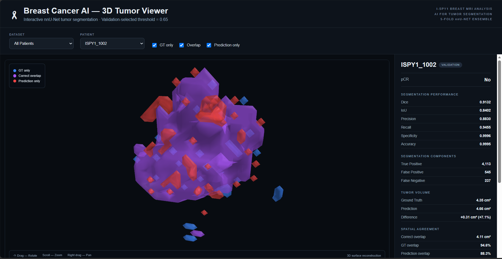
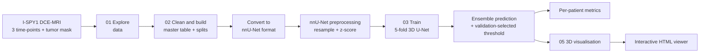
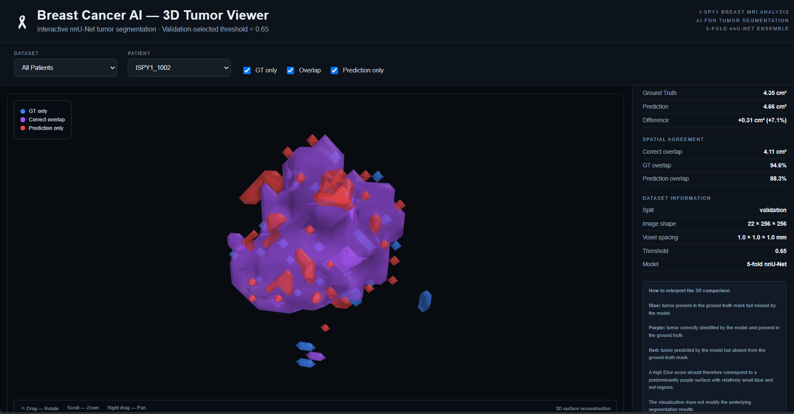
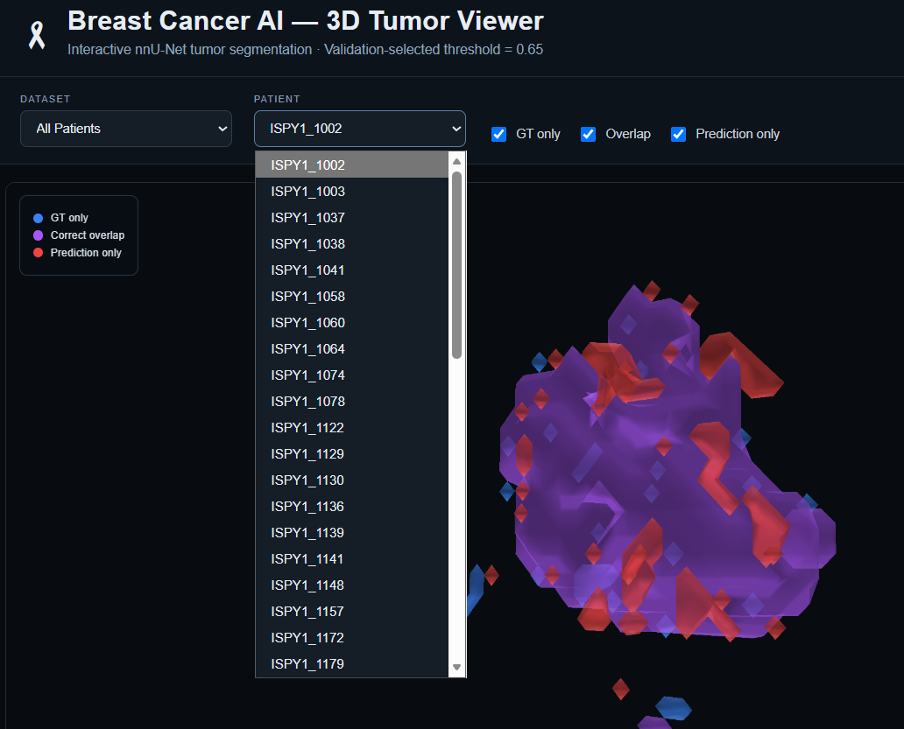
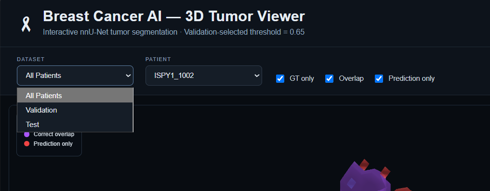
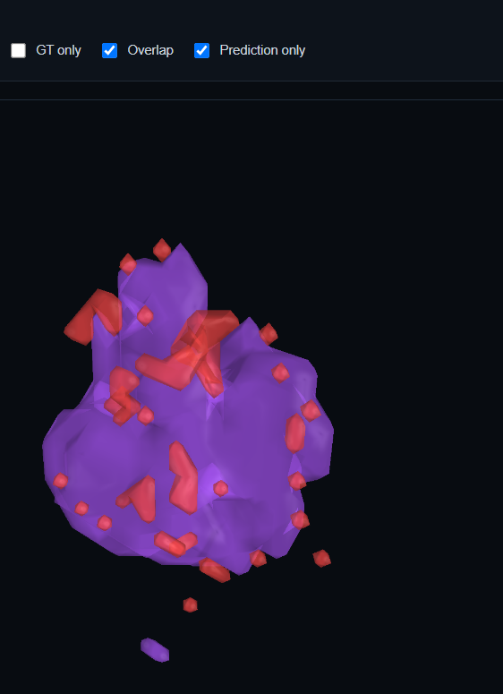
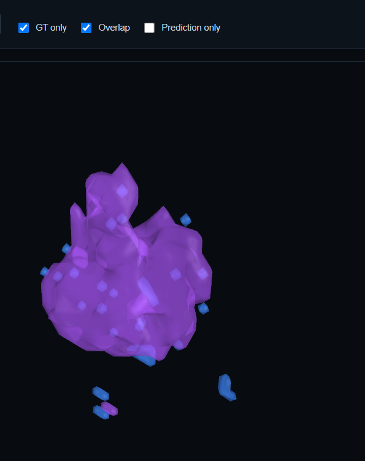
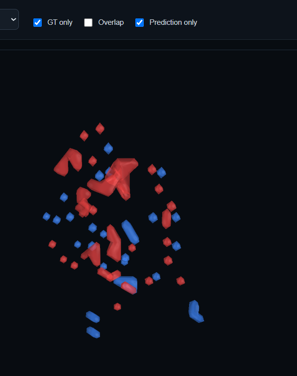

<div align="center">

# 🎗️ Breast Cancer AI
### 3D Breast Tumor Segmentation on DCE-MRI with nnU-Net, plus an Interactive 3D Viewer


### 👉 [**Launch the Live 3D Tumor Viewer**](https://vanshika900.github.io/Breast_Cancer_AI/) 👈



*Spin it, zoom into it, and see exactly where the AI agrees with the radiologist, and where it doesn't.*

</div>

---

## 📖 Table of Contents
1. [What is this project?](#-what-is-this-project)
2. [Why it matters](#-why-it-matters)
3. [The dataset](#-the-dataset)
4. [What makes this project different](#-what-makes-this-project-different)
5. [Pipeline at a glance](#-pipeline-at-a-glance)
6. [What each notebook does](#-what-each-notebook-does)
7. [Model and training setup](#-model-and-training-setup)
8. [Evaluation metrics](#-evaluation-metrics)
9. [The interactive 3D viewer](#-the-interactive-3d-viewer)
10. [Repository structure](#-repository-structure)
11. [How to reproduce](#-how-to-reproduce)
12. [Limitations and future work](#-limitations-and-future-work)
13. [References and credits](#-references-and-credits)

---

## 🧠 What is this project?

Breast MRI gives doctors a detailed 3D look inside the breast, but **outlining a tumor by hand, slice by slice, is slow and varies from one reader to another.** This project trains a deep learning model to do that outlining (**segmentation**) automatically.

In plain words:

> **Input:** a breast MRI scan taken before and after a contrast dye is injected.
> **Output:** a 3D mask that marks exactly which voxels belong to the tumor.

On top of the model, this repo includes a **browser-based 3D viewer** where you can open any patient, rotate the tumor, and compare the AI's prediction against the expert ground truth, with per-patient metrics shown next to it.

---

## 💡 Why it matters

- **Faster, more consistent measurements.** Tumor size and volume feed into treatment monitoring. An automatic mask can make them quicker to get and more repeatable.
- **Explainable by design.** Instead of a single score, the viewer shows *where* the model is right (purple), misses tumor (blue), or over-predicts (red).
- **A foundation for more.** A good segmentation is the first step for tumor-volume tracking and for studying how tumor features relate to treatment response.

> ⚠️ **Research project only. Not a medical device and not for clinical use.**

---

## 🗂️ The dataset

| | |
|---|---|
| **Source cohort** | **I-SPY1**, a breast cancer MRI cohort from a neoadjuvant (pre-surgery) chemotherapy trial |
| **Prepared version** | `BreastDCEDL`, a curated, tumor-cropped version of I-SPY1 (`ISPY1_min_crop`) |
| **Imaging type** | **DCE-MRI** (Dynamic Contrast-Enhanced MRI), 3D volumes |
| **Input channels** | 3 DCE time-points per patient (`dce_0`, `dce_1`, `dce_2`), stacked as 3 input channels |
| **Ground truth** | An expert tumor mask for every patient (`mask.nii.gz`) |
| **Scanners** | Multi-vendor: **GE, Siemens and Philips** scanners across multiple imaging sites |
| **Splits** | Patient-level **train / validation / test** split, stored in one master table |
| **Clinical metadata** | Age, ER / PR / HER2 status, receptor subtype (HR+/HER2-, HER2+, triple-negative), pCR, RCB class, tumor VOI size |

**Why I-SPY1 and not the larger MAMA-MIA dataset?**
MAMA-MIA combines several sub-datasets with different protocols and different segmentation styles. I chose to work on **one well-defined cohort that I could clean, understand and explain end to end**, rather than mix sources I couldn't fully control. A focused, reproducible study beats a sprawling one.

> 🔒 **Data is not included in this repo.** Medical imaging data has licensing and privacy rules, so only code is shared. Get the data from its original source (I-SPY1 on The Cancer Imaging Archive, and the BreastDCEDL release: *[add link]*).

---

## ✨ What makes this project different

- 🧹 **Built the dataset properly first.** Dedicated notebooks for exploration and cleaning, ending in a single **master table** that links every patient's 3 DCE volumes, mask, clinical data and train/val/test split.
- 🧩 **Handled messy real-world MRI.** Different scanners, different imaging sites, and not every patient has the same set of time-points. The pipeline had to cope with that.
- 🧠 **Used nnU-Net, a self-configuring U-Net framework.** It adapts the patch size, spacing and training plan to the dataset, and is a strong, widely respected baseline in medical image segmentation.
- 🗳️ **5-fold ensemble, not a single model.** Five models are trained on different folds and combined for more stable predictions.
- 🎚️ **Threshold chosen on the validation set** (not on the test set), to avoid tuning on data used for the final check.
- 🧊 **Built my own interactive 3D viewer.** Three-colour comparison of truth vs prediction, per-patient metrics, volume comparison and dataset-split filtering, all in the browser, no install needed.

---

## 🔄 Pipeline at a glance



---

## 📓 What each notebook does

| Notebook | Purpose |
|---|---|
| [`01_ISPY1_Data_Exploration.ipynb`](01_ISPY1_Data_Exploration.ipynb) | First look at the data: patients, scan shapes, tumor sizes, scanner and site distribution, clinical variables. Understand the data before touching a model. |
| [`02_ISPY1_Data_Cleaning.ipynb`](02_ISPY1_Data_Cleaning.ipynb) | Cleans the data and builds the **master table** (`patient_master.csv`): one row per patient with paths to the 3 DCE volumes and the mask, clinical metadata, tumor bounding-box (VOI) information, and the train / validation / test assignment. |
| [`03_ISPY1_UNet_Training.ipynb`](03_ISPY1_UNet_Training.ipynb) | Sets up and trains the nnU-Net 3D segmentation model across 5 folds. |
| [`05_Segmentation_3D_Visualization.ipynb`](05_Segmentation_3D_Visualization.ipynb) | Takes the predictions and ground truth, computes the per-patient metrics, builds 3D surfaces, and exports the interactive viewer as a single HTML file. |

---

## 🏗️ Model and training setup

| Setting | Value |
|---|---|
| Framework | **nnU-Net v2** (self-configuring U-Net) |
| Configuration | `3d_fullres`, a full 3D model that sees the whole tumor volume in context |
| Input | 3 channels (3 DCE time-points) |
| Voxel spacing | Resampled to **1.0 × 1.0 × 1.0 mm** |
| Normalisation | **Z-score**, applied per channel |
| Patch size | 256 × 256 × 32 |
| Batch size | 2 |
| Training | **5-fold cross-validation**, predictions combined as an ensemble |
| Post-processing | Probability threshold of **0.65**, selected on the validation set |

---

## 📏 Evaluation metrics

For every patient, the viewer reports a full breakdown:

| Group | What is measured |
|---|---|
| **Overlap quality** | Dice, IoU |
| **Error trade-off** | Precision, Recall, Specificity, Accuracy |
| **Voxel counts** | True Positives, False Positives, False Negatives |
| **Tumor volume** | Ground-truth volume vs predicted volume (cm³) and the difference in % |
| **Spatial agreement** | Correctly overlapping volume, % of ground truth covered, % of prediction that is correct |

📊 **Overall results (mean over the test set):**

| Metric | Validation | Test |
|---|---|---|
| Dice | *add* | *add* |
| IoU | *add* | *add* |
| Precision | *add* | *add* |
| Recall | *add* | *add* |

---

## 🧊 The interactive 3D viewer

**▶️ Try it live: https://vanshika900.github.io/Breast_Cancer_AI/**

Each tumor is reconstructed as a 3D surface in three colours:

| Colour | Meaning |
|---|---|
| 🟣 **Purple** | **Correct overlap.** The tumor was marked by both the expert and the model. |
| 🔵 **Blue** | **Missed by the model.** Tumor is in the ground truth but the model didn't predict it. |
| 🔴 **Red** | **Over-prediction.** The model predicted tumor where the ground truth has none. |

**Controls:** drag to rotate · scroll to zoom · right-drag to pan · tick or untick the three layers to isolate any one of them.

**Features:** filter by dataset split (All / Validation / Test) · choose any patient from a dropdown · full metrics panel next to the 3D view · tumor volume comparison · dataset info for each case (split, image shape, voxel spacing, threshold, model).

<table>
<tr>
<td width="50%"><br/><sub><b>Metrics panel</b> with volume comparison and spatial agreement for the selected patient.</sub></td>
<td width="50%"><br/><sub><b>Patient selector.</b> Browse every case in the cohort.</sub></td>
</tr>
<tr>
<td><br/><sub><b>Split filter.</b> View All patients, Validation only, or Test only.</sub></td>
<td><br/><sub><b>Prediction view.</b> Correct overlap (purple) plus false positives (red).</sub></td>
</tr>
<tr>
<td><br/><sub><b>Ground-truth view.</b> Correct overlap (purple) plus missed tumor (blue).</sub></td>
<td><br/><sub><b>Errors only.</b> Hide the overlap to see precisely where the model went wrong.</sub></td>
</tr>
</table>

---

## 📁 Repository structure

```
Breast_Cancer_AI/
├── 01_ISPY1_Data_Exploration.ipynb
├── 02_ISPY1_Data_Cleaning.ipynb
├── 03_ISPY1_UNet_Training.ipynb
├── 05_Segmentation_3D_Visualization.ipynb
├── docs/
│   └── index.html          # the interactive 3D viewer (served by GitHub Pages)
├── images/                 # screenshots used in this README
├── .gitignore
└── README.md
```

Notebook outputs are cleared before upload so that no patient-level information or personal file paths are published.

---

## 🚀 How to reproduce

1. **Get the data** from its original source (see [The dataset](#-the-dataset)) and place it in your own Google Drive.
2. **Open the notebooks in Google Colab**, mount your Drive, and run them in order: `01` → `02` → `03` → `05`.
3. Install nnU-Net v2 in Colab when the training notebook asks for it (`pip install nnunetv2`).
4. Update the data and output paths at the top of each notebook to match your own Drive layout.
5. The last notebook exports the HTML viewer. Open the file in any modern browser.

> 💡 A GPU runtime (**Runtime → Change runtime type → GPU**) is strongly recommended for training.

---

## 🔭 Limitations and future work

**Honest limitations**
- One cohort (I-SPY1) only, with no external validation on an independent dataset yet.
- Small-dataset setting: results can vary between patients, and very small or scattered tumor regions are the hardest cases (visible as the small blue and red fragments in the viewer).
- Research prototype, not clinically validated.

**Where this could go next**
- 🔬 External validation on a different cohort such as MAMA-MIA.
- 🧪 Benchmark nnU-Net against other segmentation architectures in a controlled comparison.
- 📈 Use the predicted tumor masks to study volume and shape features against treatment response (pCR), since the clinical outcomes are already in the master table.
- 🎯 Uncertainty estimates, to flag cases where the ensemble disagrees with itself.

---

## 📚 References and credits

- Isensee, F. et al. *nnU-Net: a self-configuring method for deep learning-based biomedical image segmentation.* **Nature Methods**, 2021.
- I-SPY1 breast MRI data, via The Cancer Imaging Archive (TCIA).
- BreastDCEDL dataset: *[add link]*.

**Author:** Vanshika · B.Tech, Jaypee Institute of Information Technology, Noida
**Guided by:** *[add your teacher's name]*

📬 Questions or feedback? Open an issue or reach out via my GitHub profile.

<div align="center">

*Built to help make tumor measurement faster, clearer, and easier to trust.* 🎗️

</div>
